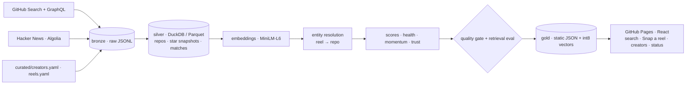

<p align="center"></p>

<h1 align="center">RepoReel</h1>
<p align="center"><b>Describe what you're building. Get the right GitHub repo, and the reel that shows it working.</b></p>
<p align="center"><a href="https://adityamalviya04692.github.io/Project-RepoReel/">Live site</a> · <a href="docs/SPEC.md">Spec</a> · <a href="docs/DESIGN.md">Design system</a> · <a href="https://adityamalviya04692.github.io/Project-RepoReel/#/pipeline">Pipeline status</a></p>

---

Builders now discover tools through short-form creators: *"this repo lets AI apply to jobs for you, comment REPO and I'll DM you"*. Search engines are bad at this, and the handoff is broken. RepoReel flips it around:

1. A **nightly data pipeline** keeps a catalog of thousands of useful repositories (AI agents, MCP servers, scraping, automation, RAG, job-search tools…) with health, momentum and community signals.
2. You **describe your need in plain language**. RepoReel understands it (task, platform, AI tool, language, location) and ranks repos by meaning, keywords, momentum, health and social proof.
3. Each result shows **reels from vetted creators** (50k+ followers, posting regularly, and accurate when checked against GitHub) using Instagram's official embed, as proof the repo does what you need.
4. Saw a reel? **Snap it**: drop a screenshot and on-device OCR reads the repo name off the frame.

## Architecture



Everything runs on **GitHub Actions + GitHub Pages**, with no servers and no paid APIs.

| Layer | What happens |
|---|---|
| **Discover** | ~45 GitHub Search queries across 16 categories, plus repos trending on Hacker News and repos named in curated reels |
| **Enrich** | Batched GraphQL (40 repos per call): stars, forks, topics, licence, releases, last push, README |
| **Silver** | DuckDB dedupes and types the bronze JSONL into Parquet; appends a **daily star snapshot** per repo (180-day window) |
| **Momentum** | Δstars over 7 and 30 days from *our own* snapshots. GitHub's public event firehose has been unreliable since March 2026, so momentum doesn't depend on it |
| **Embed** | `all-MiniLM-L6-v2` (ONNX via fastembed); the browser embeds queries with the same model (Transformers.js), so search is semantic and runs on the client |
| **Match** | Captions and on-screen text → candidates (URLs, `owner/repo`, quoted names, hashtags) → catalog / GitHub resolution → confidence = name similarity, semantic similarity, owner, popularity. Uncertain matches go to a review queue |
| **Score** | Repo health, momentum, social proof; creator trust = 0.35 accuracy + 0.25 consistency + 0.20 engagement + 0.20 recency, behind eligibility gates |
| **Quality** | Contract checks (uniqueness, alignment, referential integrity, plausible velocity). A failure blocks publishing |
| **Eval** | Golden queries scored with hit@1, hit@3 and MRR on every run, shown on the status page |

## Add creators and reels

Edit two files. The next pipeline run validates them, matches reels to repos and computes trust.

```yaml
# curated/creators.yaml
creators:
  - handle: some_creator      # real public professional account
    followers: 120000
    niche: ai-tools
```

```yaml
# curated/reels.yaml
reels:
  - url: https://www.instagram.com/reel/SHORTCODE/
    creator: some_creator
    posted: 2026-10-20
    repo: owner/name           # or paste the caption / on-screen text instead:
    caption: "this repo browser-use lets AI control your browser"
```

## Run locally

```bash
python3 -m venv .venv && .venv/bin/pip install -r requirements.txt
export GITHUB_TOKEN=$(gh auth token)
.venv/bin/python -m pipeline.cli run          # ~15 min for the full catalog; --limit 300 for a quick run
.venv/bin/python -m pytest -q tests

cd web && npm install && npm run dev
```

## Responsible by design
- **No scraping.** Reels are displayed with Instagram's official embed; embed data is never stored or analysed. Creator data comes from curated files now and Meta's Business Discovery API (with app review) in P1.
- **Snap a reel** runs OCR on the user's own screenshot, in their browser. Nothing is uploaded.
- Creators can ask to be removed; dead posts are dropped on the next run.
- Health flags (archived, stale, no licence) and a "read the code before running it" note on every repo.

## Roadmap
- **P0** (this release): catalog, snapshots, HN signal, matching, in-browser semantic search, Snap a reel, creators, pipeline status
- **P1**: Instagram Business Discovery for allowlisted creators (followers, captions, engagement), automatic trust updates
- **P2**: creator opt-in submissions with frame OCR and speech-to-text
- **P3**: an MCP server so Claude can query RepoReel directly; weekly digests per use case

## Stack
Python 3.12 · httpx · DuckDB · Pydantic · fastembed · React 19 · TypeScript · Vite · Motion · Transformers.js · Tesseract.js · GitHub Actions · GitHub Pages

Design language adapted from the Apple DESIGN.md in [VoltAgent/awesome-design-md](https://github.com/VoltAgent/awesome-design-md) (MIT). Not affiliated with GitHub, Meta, Instagram or Apple.

MIT © Aditya Malviya
