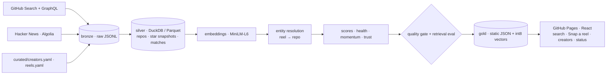

<p align="center"></p>

<h1 align="center">RepoReel</h1>
<p align="center"><b>Describe what you're building. Get the right GitHub repo, and the reel that shows it working.</b></p>
<p align="center"><a href="https://adityamalviya04692.github.io/Project-RepoReel/">Live site</a> · <a href="docs/SPEC.md">Spec</a> · <a href="docs/DESIGN.md">Design system</a> · <a href="docs/PROJECT_STATUS.md">Implementation status</a> · <a href="https://adityamalviya04692.github.io/Project-RepoReel/#/pipeline">Pipeline status</a></p>

---

Builders now discover tools through Instagram reels (*"this repo lets AI apply to jobs for you, comment REPO and I'll DM you"*), but when you need one later you can't find it again, on Instagram or on Google. **RepoReel takes your problem and hands you back the exact reel to watch**, with the repo it talks about one tap away.

1. **Ask in plain language.** A large ask panel understands the task, the platform, the AI tool, the language and the location.
2. **Get reels, not links.** Reels are ranked by meaning (on-device MiniLM embeddings), keywords, recency, creator trust and repo health. They play in a phone on the right with Instagram's official embed; every reel carries the repo it mentions and an **Open repo** button.
3. **Verify before you use.** Each answer shows the repo's stars, weekly momentum, last push and licence from a nightly pipeline over 4,000+ repositories. When no reel covers your need yet, the closest repos are listed instead.
4. **Saw a reel elsewhere?** **Snap it** (on-device OCR on a screenshot) to get the repo, or **Add it**: it's indexed instantly in your browser and exports as `reels.yaml` lines for everyone.

## Architecture



The catalog and site run on **GitHub Actions + GitHub Pages**, with no always-on server. Optional Instagram discovery uses metered Apify usage credit.

| Layer | What happens |
|---|---|
| **Discover** | ~45 GitHub Search queries across 16 categories, plus repos trending on Hacker News and repos named in curated reels |
| **Enrich** | Batched GraphQL (40 repos per call): stars, forks, topics, licence, releases, last push, README |
| **Silver** | DuckDB dedupes and types the bronze JSONL into Parquet; appends a **daily star snapshot** per repo (180-day window) |
| **Momentum** | Δstars over 7 and 30 days from *our own* snapshots. GitHub's public event firehose has been unreliable since March 2026, so momentum doesn't depend on it |
| **Embed** | `all-MiniLM-L6-v2` (ONNX via fastembed); the browser embeds queries with the same model (Transformers.js), so search is semantic and runs on the client |
| **Match** | Captions and on-screen text → candidates (URLs, `owner/repo`, quoted names, hashtags) → catalog / GitHub resolution → confidence = name similarity, semantic similarity, owner, popularity. Uncertain matches go to a review queue |
| **Score** | Repo health, momentum, social proof; creator trust = 0.35 accuracy + 0.25 consistency + 0.20 engagement + 0.20 recency, behind eligibility gates |
| **Quality** | Contract checks (uniqueness, alignment, referential integrity, plausible velocity). A failure blocks publishing |
| **Eval** | Golden queries scored with hit@1, hit@3 and MRR on every run, shown on the status page |

## Automated reel discovery (free)

No manual curation is needed. Discovery is built around **creators**, not hashtags: most reels from a
creator who posts about repos are repo reels, so their feeds give far more per call than any hashtag.
Every run of the pipeline:

1. **Finds new posts about repos**: Meta's free **Hashtag Search** (public posts from the last 24 hours for
   `#githubrepo`, `#github`, `#opensource`, … when the Graph API is connected) and a few precise
   **Apify** hashtag/keyword searches. Apify's free plan gives $5 of usage a month; the pipeline spreads
   what is left under a $4.50 cap evenly over the days remaining in the cycle, checks usage before every
   actor launch, caps each run at $0.25 provider-side and never retries a billable request.
2. **Keeps only English reels about a repo** (`pipeline/classify.py`: script check, stopword vote, and a
   GitHub / open-source / repo / `owner/name` signal). Rejected reels are remembered and never judged twice.
3. **Reads the feeds of repo creators**: anyone with English repo reels. Meta's free **Business Discovery**
   API returns a creator's reels page by page, so every creator's *whole* public history is crawled and
   then refreshed daily. Creators tagged in repo-reel captions are probed with one call and join when they
   post about repos too, so the creator graph keeps growing. The nightly job crawls for up to 4 hours,
   pausing whenever Meta's hourly allowance (~200 calls) is nearly used; progress is committed even if a
   later stage fails. Creators the API can't read (personal accounts, or no Graph token) get Apify reel feeds.
4. **Extracts the repo**: GitHub URLs, `owner/name`, names and hashtags in the caption, GitHub search for
   names not in the catalog (answers cached), and Tesseract OCR of the reel cover when the caption only
   says "comment REPO". Reels whose repo stays unknown are still shown, labelled "repo not named".
5. **Vets creators** (followers, regular repo posts, accuracy, engagement, recency) and keeps every repo reel:
   history is sharded by month in `data/history/reels/`, matches are cached per reel, and the site gets the
   newest 12,000 reels up front plus every repo's reels in 256 on-demand shards (`web/public/data/reels/`).

| Secret / variable | Where | What |
|---|---|---|
| `APIFY_TOKEN` | repo secret | free token from console.apify.com → Settings → Integrations |
| `IG_USER_ID`, `IG_ACCESS_TOKEN` | repo secrets (recommended) | Graph API: creator feeds + hashtag search, free. This is what makes the index grow quickly |
| `VITE_LIVE_URL` | repo variable (optional) | URL of the deployed live-search worker |

**Connecting the Graph API (about 15 minutes, free):**
1. In the Instagram app, switch your account to a Professional account (Creator or Business) and link it to a Facebook Page.
2. At developers.facebook.com create a Business app and add Instagram Graph API (the Facebook Login variant).
   For hashtag search, also request the *Instagram Public Content Access* feature (standard access is enough for your own account).
3. In the Graph API Explorer, generate a user token with `instagram_basic`, `pages_show_list`, `pages_read_engagement` and `business_management`;
   exchange it for a long-lived token, then call `me/accounts` with it: the Page token it returns does not expire.
4. `GET {page-id}?fields=instagram_business_account` gives `IG_USER_ID`. Save both as repo secrets:
   `gh secret set IG_USER_ID` and `gh secret set IG_ACCESS_TOKEN`.

The Pipeline page reports each source's status, including an expired token or a missing permission.

At query time the site searches that index instantly. When nothing fits, an optional free **Cloudflare Worker** (`worker/`) searches Instagram live for the query's keywords: cached for 7 days, capped per day, and budget-guarded.

| Secret / variable | Where | What |
|---|---|---|
| `APIFY_TOKEN` | repo secret | free token from console.apify.com → Settings → Integrations (turns discovery on) |
| `IG_USER_ID`, `IG_ACCESS_TOKEN` | repo secrets (optional) | Instagram Professional account + Meta app token, for free follower counts via Business Discovery |
| `VITE_LIVE_URL` | repo variable (optional) | URL of the deployed live-search worker |

> Reels are always displayed with Instagram's official embed. Discovery uses Meta's official Graph API and a third-party data provider (Apify) for public posts; it never logs in to Instagram or works around its access controls. Check that this fits your situation and Instagram's terms.

You can still add reels by hand in `curated/reels.yaml`, or from the site's "Know a reel we missed?" link.

## Run locally

```bash
python3 -m venv .venv && .venv/bin/pip install -r requirements.txt
export GITHUB_TOKEN=$(gh auth token)
.venv/bin/python -m pipeline.cli run          # ~15 min for the full catalog; --limit 300 for a quick run
.venv/bin/python -m pytest -q tests

cd web && npm install && npm run dev
```

## Responsible by design
- Reels are displayed with Instagram's official embed; embed data is never stored or analysed. Discovery includes usage checks, per-run charge caps, daily caps and caching. Free-tier availability and actor pricing depend on the provider.
- **Snap a reel** runs OCR on the user's own screenshot, in their browser. Nothing is uploaded.
- Report removed posts or request creator removal through a GitHub issue. History expires after 120 days; automatic deleted-post detection is not implemented.
- Health flags (archived, stale, no licence) and a "read the code before running it" note on every repo.

## Roadmap
- **P0** (this release): catalog, snapshots, HN signal, matching, in-browser semantic search, Snap a reel, creators, pipeline status
- **P1**: Validate connected Instagram discovery and creator trust against real provider responses; Business Discovery integration is implemented but needs credentials
- **P2**: creator opt-in submissions with frame OCR and speech-to-text
- **P3**: an MCP server so Claude can query RepoReel directly; weekly digests per use case

## Stack
Python 3.12 · httpx · DuckDB · Pydantic · fastembed · React 19 · TypeScript · Vite · Motion · Transformers.js · Tesseract.js · GitHub Actions · GitHub Pages

Design language adapted from the Apple DESIGN.md in [VoltAgent/awesome-design-md](https://github.com/VoltAgent/awesome-design-md) (MIT). Not affiliated with GitHub, Meta, Instagram or Apple.

MIT © Aditya Malviya
