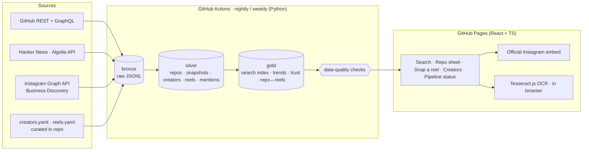

# RepoReel — product & technical specification

> **Describe what you're building. Get the right GitHub repo, and the reel that shows it working.**

Status: v0.1 spec · Owner: Aditya Malviya · Last updated: 23 Oct 2026

---

## 1. Problem

People increasingly discover useful GitHub repositories (AI agents, MCP servers, automation and scraping tools) through short-form creators on Instagram, not search engines. That has three problems:

1. **Search is hard.** Googling "repo that applies to jobs in Pune with Claude" returns blog spam, not the repo.
2. **The handoff is broken.** Reels say "comment REPO and I'll DM you", so the name sits behind engagement bait.
3. **Trust is unclear.** Is this creator credible? Is the repo alive, licensed and safe?

## 2. Product in one paragraph

RepoReel keeps a **trusted, continuously refreshed catalog of GitHub repositories** and links each repo to **reels from vetted creators** that explain it. A user describes their need in plain language. RepoReel understands the task and its constraints, returns the best 3–5 repos with reasons, health and momentum, and embeds the best recent reel for each as social proof. **The repo is the answer; the reel is the validation.**

## 3. Users and core jobs

| User | Job to be done |
|---|---|
| Builder / job-seeker / student | "I need a tool that does X with my AI assistant. Show me the right repo and prove it works." |
| Someone who saw a reel | "I saw this reel. Which repo was it?" → **Snap a reel** (screenshot → repo) |
| Creator | "Index my reels so people find the repos I review" (opt-in, later phase) |

**Non-goals:** not a social network, not a scraper, not a general GitHub search clone, and no hosting or running of the repos.

## 4. Key decisions (and why)

| Decision | Choice | Reason |
|---|---|---|
| Direction | **Repo-first, reels as proof** | Repo data is open and reliable; Instagram data is gated. Starting from repos makes every answer verifiable. |
| Instagram access | **Official APIs only:** Business Discovery, the official embed, user-provided content, creator opt-in | Meta's terms forbid scraping. Embeds are display-only: oEmbed data may not be stored or analysed. |
| Repo momentum | **Our own nightly star snapshots** | GitHub public event-derived rankings (GH Archive / OSS Insight) have been unreliable since Mar 2026; OSS Insight marks them "unavailable". Snapshots from the GitHub API are exact. |
| "Backend" | **A scheduled data pipeline on GitHub Actions** writing static, versioned data files; no always-on server | Free, auditable, reproducible, and it deploys entirely from GitHub. |
| Search | **In the browser:** hybrid keyword + embeddings (MiniLM via Transformers.js), same approach as Corpus | No server cost, private, fast after first load. |
| Design | **Apple design language** from `VoltAgent/awesome-design-md` (Apple DESIGN.md, MIT), adapted in [`DESIGN.md`](DESIGN.md) | Calm, photography-first layout suits embedded video; one accent colour keeps it focused. |

## 5. System architecture



**Deploy flow:** `pipeline.yml` (cron) → writes `data/` artifacts → commits to a `data` branch (or a GitHub Release) → `deploy.yml` builds the site with the latest data → GitHub Pages.

## 6. Data sources and access

### 6.1 GitHub (core catalog)
- **Discovery (daily):** Search API queries by category and time window, e.g. `topic:mcp-server stars:>30 pushed:>2026-09-01`, `"claude" in:readme stars:>50 created:>…`, plus category seeds (job search, scraping, automation, data, agents, RAG, browser automation).
- **Enrichment (daily, batched):** GraphQL, up to 100 repos per query: `stargazerCount, forkCount, pushedAt, createdAt, licenseInfo, primaryLanguage, repositoryTopics, description, homepageUrl, isArchived, latestRelease`, plus the README's first ~4 KB (REST).
- **Snapshots:** one row per repo per day (`stars, forks, open_issues, pushed_at`), so velocity = Δstars over 7 and 30 days, computed by us.
- **Limits:** the Actions `GITHUB_TOKEN` (or a fine-grained PAT) covers a ~20k-repo catalog with GraphQL batching. Search is 30 requests/min, so discovery is throttled.

### 6.2 Hacker News (independent validation)
- Algolia HN Search API: stories and comments containing `github.com/{owner}/{repo}`, giving mention counts and dates. Free, no key.

### 6.3 Instagram (creators and reels)
| Path | What we get | Status |
|---|---|---|
| **Curated files** (`creators.yaml`, `reels.yaml`) | Creator handles; reel permalinks with the repo they feature | P0: works without any Meta access |
| **Business Discovery API** (Instagram API with Facebook Login; your Business/Creator account; permissions `instagram_basic`, `pages_read_engagement`, …) | For each *allowlisted* Business/Creator account: `followers_count`, `media_count`, recent media (caption, permalink, timestamp, product type, like/comment/view counts) | P1: needs a Meta app + review. Age-gated accounts are excluded; `media_url` is omitted for licensed audio and download-disabled reels. |
| **Official embed** (`blockquote.instagram-media` + `embed.js`) | Plays the creator's reel in our page | P0: display only. Embed or oEmbed data is never stored or analysed. |
| **Snap a reel** (user screenshot) | OCR in the user's browser reads `owner/repo` or a GitHub URL from the frame | P0: nothing scraped; the user brings the content |
| **Creator opt-in** | Creators submit reels; we may run OCR and speech-to-text on frames to read on-screen repo names | P2: with explicit permission only |

**Compliance rules:** no scraping or bulk downloads; only allowlisted public professional accounts; store the minimum (permalink, timestamp, counts, matched repo, match evidence); delete records when a post disappears or on request; a takedown contact in the README.

## 7. Data model (medallion)

**Bronze (raw, append-only JSONL, partitioned by `ingest_date`):** `gh_search_hits`, `gh_repo_graphql`, `gh_readme`, `hn_hits`, `ig_business_discovery`, `curated_creators`, `curated_reels`.

**Silver (typed and deduplicated, Parquet):**
| Table | Key | Notable columns |
|---|---|---|
| `repos` | `repo_id` (GitHub node id) | `full_name, description, topics[], language, license, created_at, pushed_at, archived, readme_excerpt, categories[], ai_compat[]` |
| `repo_snapshots` | `(repo_id, snapshot_date)` | `stars, forks, open_issues` |
| `repo_aliases` | `alias` | renamed or transferred names → `repo_id` (from redirects) |
| `creators` | `ig_username` | `followers, media_count, niche, source (curated / bd), last_seen` |
| `reels` | `permalink` | `creator, posted_at, caption_hash, likes, comments, views` |
| `reel_repo_matches` | `(permalink, repo_id)` | `method (url / handle / fuzzy / ocr / manual), confidence, evidence` |
| `hn_mentions` | `(hn_id, repo_id)` | `points, created_at` |

**Gold (served to the site as static files):**
- `search_index`: one row per repo with text fields, facets, a 384-d embedding (int8-quantised) and scores.
- `repo_trend_daily`: velocity 7d/30d, momentum rank per category.
- `creator_trust`: score components and badge.
- `repo_reels`: top reels per repo, ranked.
- `pipeline_runs`: timings, row counts, quality-check results (feeds the **Pipeline status** page).

## 8. Matching reels to repos (entity resolution)

1. **Extract candidates** from caption text (and OCR text, where permitted): GitHub URLs; `owner/repo` patterns; backticked or quoted names; "repo called X"; hashtags such as `#browseruse`.
2. **Normalise:** lowercase, strip punctuation, map `-`/`_`/spaces, apply alias table.
3. **Generate candidates:** exact match on `full_name` → name-only match within the catalog → GitHub Search fallback (rate-limited, cached).
4. **Score:** `0.45 name similarity (trigram) + 0.35 semantic similarity (caption ↔ README embedding) + 0.10 owner match + 0.10 popularity prior`.
5. **Decide:** ≥0.80 accept; 0.55–0.80 goes to `review_queue.csv` for one-click human confirmation; <0.55 reject. Evidence is stored for every decision.

## 9. Scoring

**Creator eligibility gates (all required):**
- ≥ **50,000 followers** (≥ 100,000 earns the "Top creator" badge)
- ≥ **4 repo posts in the last 60 days** (regular posting)
- Account is public, professional and not age-gated

**Creator trust (0–1):**
`trust = 0.35·accuracy + 0.25·consistency + 0.20·engagement + 0.20·recency`
- *accuracy*: share of a creator's repo claims whose matched repo exists, isn't archived, was pushed within 180 days, and whose README agrees with the caption.
- *consistency*: repo posts per 30 days, capped.
- *engagement*: likes + comments per view (or per follower), as a percentile within the niche. This penalises bought audiences.
- *recency*: exponential decay on the last repo post.

**Repo health (0–1):** recent push, not archived, has a licence, issues being closed, release cadence, a README that runs to install steps.

**Query ranking:**
`score = 0.50·semantic + 0.15·keyword + 0.12·momentum + 0.10·health + 0.08·social_proof + 0.05·freshness`, after hard filters (AI tool, language, licence) parsed from the query.
`social_proof` = trust-weighted reel count + HN mentions.

**Reel ranking per repo:** `creator_trust × match_confidence × recency × engagement`.

## 10. Query understanding

The query is parsed into facets: **task** ("job search automation"), **domain** ("data roles"), **constraints** (location "Pune", platform "LinkedIn/Naukri", language "Python"), and **AI tool** (Claude / MCP, ChatGPT, Gemini, any). Rules and keyword lexicons run in the browser; a small model can optionally rewrite the query. Facets become filters plus a rewritten semantic query. The UI shows them as editable chips: *"Understood: job search · LinkedIn · works with Claude."*

## 11. User experience

Apple design language (see `DESIGN.md`): calm, one accent colour, content first.

1. **Home:** large headline "What are you building?", a single pill search field, example chips, a dark "Rising this week" tile, and a light "Trusted creators" tile.
2. **Results:** 3–5 repo cards. Each shows name, one-line reason, health strip (★ and Δ7d, last push, licence, AI-compat icons), and a row of 1–3 embedded reels with creator trust badges. "Why this repo?" expands the matched facets and evidence.
3. **Repo sheet:** a spring-driven bottom sheet, draggable with velocity handoff; README excerpt, momentum sparkline, all reels, HN threads, an "Open on GitHub" pill.
4. **Snap a reel:** drop or paste a screenshot → OCR in the browser → matched repo(s) with confidence → the same card.
5. **Creators:** vetted creators with trust breakdowns (accuracy, consistency, engagement, recency).
6. **Pipeline status (data engineering showcase):** last run, rows per layer, quality checks, freshness, lineage diagram.

Motion: critically damped springs by default (response ~0.35 s); a bouncier spring only for the flick-to-dismiss sheet; respects `prefers-reduced-motion` and `prefers-reduced-transparency`.

## 12. Quality, evaluation and observability
- **Data contracts:** Pydantic schemas per silver table; checks for nulls, uniqueness, foreign keys, value ranges, snapshot continuity; the run fails on breach.
- **Retrieval evaluation:** a golden set of ~40 needs → expected repos; hit@1, hit@3 and MRR are reported on every pipeline run.
- **Matching evaluation:** a labelled caption set; precision and recall per method.
- **Freshness SLOs:** catalog under 26 h old; creator data under 8 days old; the site shows a banner if stale.

## 13. Repository layout
```
reporeel/
├─ pipeline/            # Python 3.12 package
│  ├─ sources/          # github.py, hn.py, instagram.py, curated.py
│  ├─ transforms/       # bronze→silver→gold (DuckDB SQL + Polars)
│  ├─ matching/         # extract.py, resolve.py
│  ├─ scoring/          # trust.py, health.py, momentum.py
│  ├─ quality/          # contracts.py, checks.py
│  └─ cli.py            # `reporeel run --stage all`
├─ curated/             # creators.yaml, reels.yaml, golden_queries.yaml
├─ web/                 # React + TS + Vite site (GitHub Pages)
├─ data/                # published gold artifacts (data branch)
├─ docs/                # SPEC.md, DESIGN.md, architecture images
└─ .github/workflows/   # pipeline.yml (cron), deploy.yml, ci.yml
```
Stack: Python (httpx, DuckDB, Polars, Pydantic, sentence-transformers), React 19 + TypeScript + Vite, Motion, Transformers.js, Tesseract.js, Vitest + pytest.

## 14. Roadmap
| Phase | Scope | Outcome |
|---|---|---|
| **P0 — MVP** | GitHub catalog + snapshots, HN mentions, curated creators and reels, entity resolution, in-browser search, embeds, Snap a reel, Pipeline status page, deploy | Live demo on GitHub Pages |
| **P1** | Business Discovery ingestion for allowlisted creators, trust scoring, review queue | Creators update automatically |
| **P2** | Creator opt-in submissions; OCR and speech-to-text on frames, with permission | Reads on-screen repo names |
| **P3** | MCP server ("ask RepoReel from Claude"), weekly email/RSS digest per use case | RepoReel inside AI tools |

## 15. Risks and mitigations
| Risk | Mitigation |
|---|---|
| Meta app review delayed or denied | P0 runs fully on curated files and embeds; Business Discovery is additive |
| Embeds blocked (creator disabled embeds, deleted post) | Fall back to a permalink card; nightly link check removes dead reels |
| Malicious or abandoned repos promoted by creators | Health score, archived/stale flags, licence display, "review before running" note |
| Creator bias or popularity loops | Accuracy weighs most; HN gives independent validation; momentum is capped |
| GitHub rate limits | GraphQL batching, ETag caching, incremental refresh by tier (hot repos daily, long tail weekly) |

## 16. Open inputs needed from the owner
1. **Seed creators:** 15–30 Instagram handles that post about repos (meeting the gates).
2. **Seed reels:** for the demo, 2–3 reel links per creator with the repo each features.
3. **Meta developer setup (P1):** an Instagram Professional account linked to a Facebook Page, plus a Meta app.
4. Confirm the name **RepoReel** and the repo name `Project-RepoReel`.

---
*Design language adapted from the Apple DESIGN.md in [VoltAgent/awesome-design-md](https://github.com/VoltAgent/awesome-design-md) (MIT). Not affiliated with Apple or Meta.*
